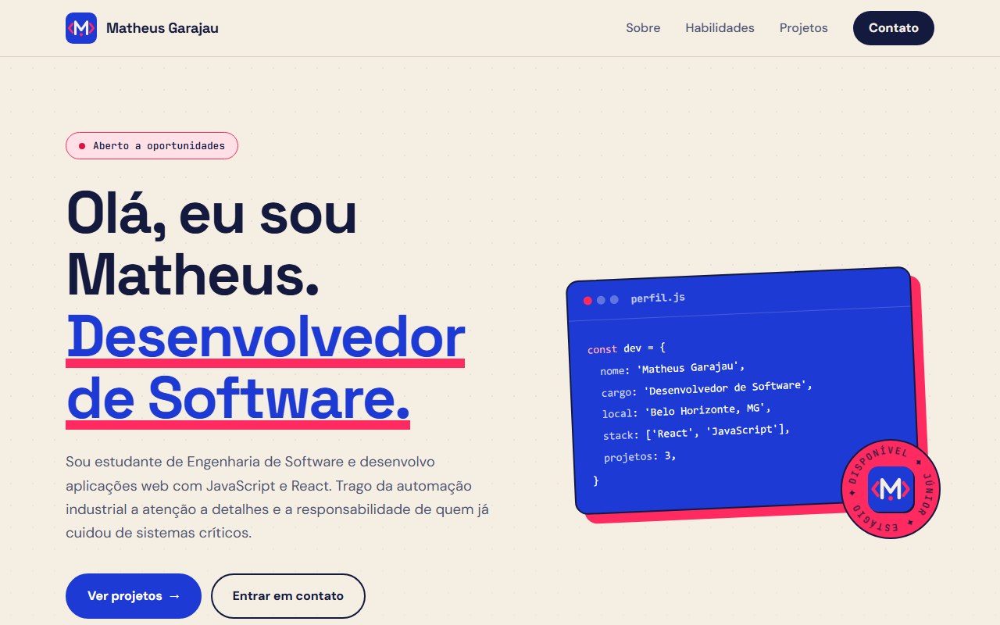

# 💼 Portfólio — Matheus Garajau

Meu portfólio pessoal, desenvolvido do zero com **React** e **Vite**, reunindo quem sou, minha trajetória e os projetos que já construí.

🔗 **Ver online:** https://mgarajau.github.io/portfolio/



## ✨ Seções

- **Início**: apresentação, cartão de perfil em formato de código e faixa animada com as tecnologias
- **Sobre**: minha história e linha do tempo de formação e experiência
- **Habilidades**: tecnologias organizadas em grupos (front-end, back-end e ferramentas)
- **Projetos**: cada projeto com print, descrição, tecnologias e links para ver online e ver o código
- **Contato**: LinkedIn, e-mail e GitHub

## 🧠 O que pratiquei

- **Componentização**: cada parte da página é um componente com seu próprio CSS
- **Props**: um único componente `CardProjeto` reutilizado para todos os projetos
- **Renderização de listas** com `.map()` e renderização condicional com `&&`
- **Estado** com `useState` no menu do celular
- **Dados separados do visual**: textos e projetos ficam em `src/data/`, sem precisar mexer nos componentes
- **Layout responsivo** com CSS Grid (`auto-fill` + `minmax`), Flexbox e Media Queries
- **Variáveis CSS** para manter cores e espaçamentos consistentes (azul, bege e rosa)
- **Logo em SVG** como componente React, reaproveitada no cabeçalho, no topo e no ícone da aba
- **Acessibilidade**: HTML semântico, `aria-label`, foco visível para navegação pelo teclado e respeito a `prefers-reduced-motion`

## 🛠️ Tecnologias


## 📁 Estrutura

```
src/
├── components/     # Header, Logo, Hero, FaixaTecnologias, Sobre, Habilidades,
│                   # Projetos, CardProjeto, Contato e Rodape
├── data/
│   ├── perfil.js   # nome, resumo, links, trajetória, tecnologias e habilidades
│   └── projetos.js # lista de projetos exibidos
├── App.jsx         # monta a página juntando os componentes
├── index.css       # estilos globais e variáveis de cor
└── main.jsx        # ponto de entrada do React
public/
└── projetos/       # prints dos projetos
```

## ✏️ Como atualizar o conteúdo

- **Mudar textos ou links:** edite `src/data/perfil.js`
- **Adicionar um projeto:** coloque o print em `public/projetos/` e acrescente um objeto em `src/data/projetos.js`
- **Mudar as cores do site:** altere `--cor-azul`, `--cor-rosa` e `--cor-fundo` em `src/index.css`

## ▶️ Como rodar localmente

```bash
npm install
npm run dev
```

## 🚀 Como publicar uma atualização

```bash
npm run deploy
```

Esse comando gera a versão final (`npm run build`) e envia a pasta `dist` para o branch `gh-pages`, que é o que o GitHub Pages publica. Em um ou dois minutos o site é atualizado.

## 👤 Autor

**Matheus Garajau** · [LinkedIn](https://www.linkedin.com/in/matheus-garajau/) · [GitHub](https://github.com/mgarajau)
